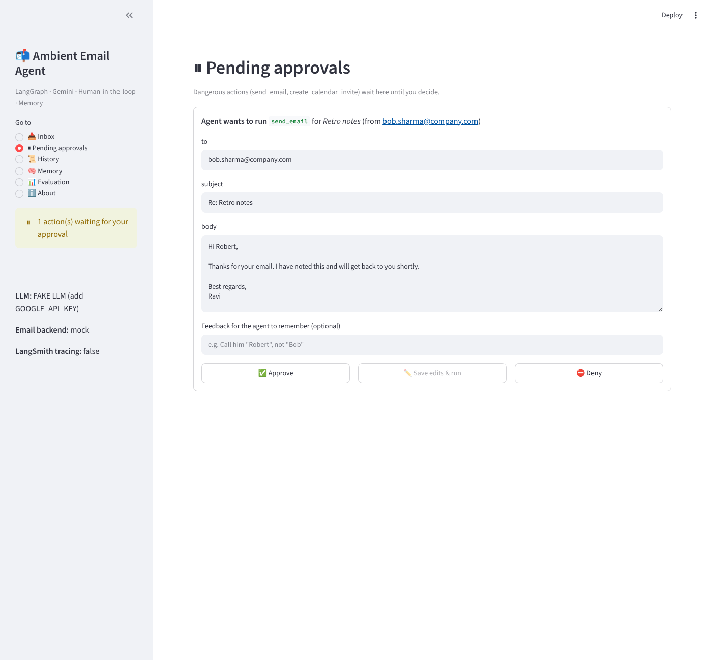
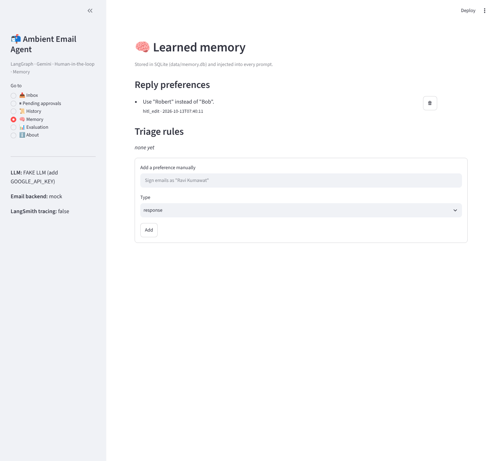
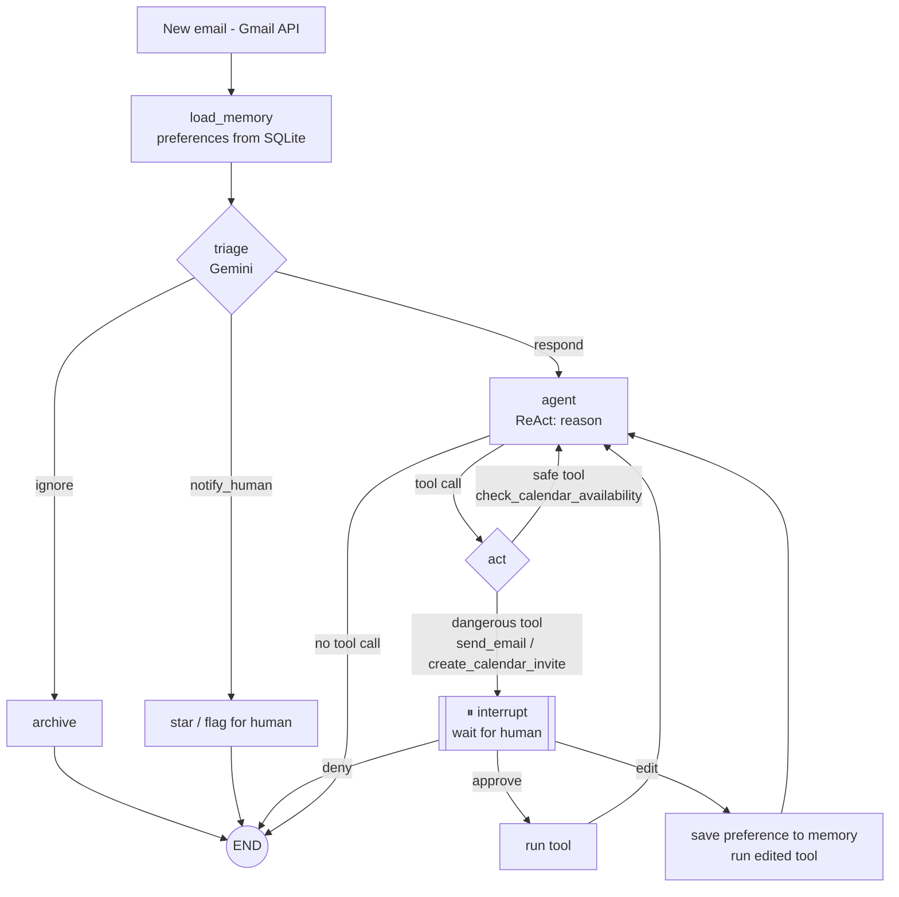

# 📬 Ambient Email Assistant Agent — LangGraph + Gemini

An **autonomous ("ambient") email assistant** that watches an inbox, triages every email, drafts replies with a
ReAct tool loop, **pauses for human approval** before anything risky, and **learns from your edits**.

Built for the **Infosys Springboard AI Internship** project *"Building an Ambient Agent with LangGraph for an Email Assistant"*.


| Pending approval (HITL) | Learned memory |
|---|---|
|  |  |

---

## ✨ Features

| Milestone | What it does | Where |
|---|---|---|
| **M1 · Triage + ReAct** | Gemini classifies each email as `ignore` / `notify_human` / `respond`; a ReAct loop reasons and calls tools | `agent/graph.py` |
| **M2 · Evaluation** | 105-email dataset with human labels + ideal replies; **LLM-as-a-judge** scores helpfulness, tone, correctness (local + LangSmith) | `data/eval_dataset.json`, `agent/judge.py`, `evals/` |
| **M3 · Human-in-the-loop** | `send_email` and `create_calendar_invite` are *dangerous* → the graph calls `interrupt()` and waits for **Approve / Edit / Deny** | `act` node in `agent/graph.py` |
| **M4 · Memory + Deployment** | SQLite checkpoints (paused runs survive restarts) + SQLite preference memory; edits become preferences ("call Bob *Robert*"); real **Gmail + Google Calendar** APIs | `agent/memory.py`, `agent/services.py`, `ambient.py` |
| **UI** | Streamlit app: inbox, pending approvals, history + triage corrections, memory editor, evaluation dashboard | `app.py` |

## 🧭 Workflow



## 🗂 Project structure

```
ambient-email-agent/
├── agent/
│   ├── graph.py        # LangGraph StateGraph: load_memory → triage → agent ⇄ act (HITL)
│   ├── tools.py        # safe + dangerous tools
│   ├── services.py     # mock back-end and real Gmail / Calendar back-end
│   ├── memory.py       # SQLite preference memory + run history
│   ├── runner.py       # process() / resume() helpers used everywhere
│   ├── judge.py        # LLM-as-a-judge
│   └── llm.py          # Gemini (or offline FakeLLM when no key)
├── evals/
│   ├── triage_accuracy.py    # M1  target > 80 %
│   ├── quality.py            # M2  LLM-as-a-judge quality score
│   ├── langsmith_eval.py     # M1+M2 as a LangSmith experiment
│   ├── hitl_trajectory.py    # M3  target 100 % paused
│   └── memory_adaptation.py  # M4  Bob → Robert test
├── data/
│   ├── golden_set.json       # 35 emails (M1)
│   └── eval_dataset.json     # 105 emails + ideal replies (M2)
├── notebooks/walkthrough.ipynb
├── tests/                    # pytest, runs offline
├── app.py                    # Streamlit UI
├── ambient.py                # background Gmail watcher
├── main.py                   # CLI demo
├── scripts/hello_gemini.py   # check your API key
└── docs/GMAIL_SETUP.md
```

## 🚀 Quick start

```bash
git clone https://github.com/YOUR_USERNAME/ambient-email-agent.git
cd ambient-email-agent
python -m venv .venv
# Windows:  .venv\Scripts\activate        macOS/Linux:  source .venv/bin/activate
pip install -r requirements.txt
copy .env.example .env          # macOS/Linux: cp .env.example .env
```

Open `.env` and add your Gemini key from <https://aistudio.google.com/> (and optionally LangSmith):

```
GOOGLE_API_KEY=your_key_here
GEMINI_MODEL=gemini-3.8-flash
LANGSMITH_TRACING=true
LANGSMITH_API_KEY=your_langsmith_key
```

> No key? Everything still runs with an offline **FakeLLM** so you can test the pipeline — but its numbers are not real results.

```bash
python scripts/hello_gemini.py     # 1. check the key works
streamlit run app.py               # 2. open the UI at http://localhost:8501
python main.py e29                 # 3. or use the CLI (asks Approve / Edit / Deny in the terminal)
```

## 📊 Evaluation

Free Gemini keys are rate-limited, so use `--delay 4` (seconds between emails).

```bash
python -m evals.triage_accuracy --delay 4                                  # M1 (35 emails)
python -m evals.triage_accuracy --dataset data/eval_dataset.json --delay 4 # M1 on all 105
python -m evals.quality --delay 4                                          # M2 LLM-as-a-judge
python -m evals.langsmith_eval                                             # M2 in LangSmith
python -m evals.hitl_trajectory --delay 4                                  # M3
python -m evals.memory_adaptation                                          # M4
pytest -q                                                                  # unit tests (offline)
```

Results are written to `results/*.json` and shown on the **📊 Evaluation** page of the UI.

| Metric | Target | My result (Gemini) |
|---|---|---|
| Triage accuracy (golden set) | > 80 % | _fill in_ |
| Quality score (LLM-as-a-judge, 0–1) | framework runs on 100+ cases | _fill in_ |
| HITL trajectory accuracy | 100 % | _fill in_ |
| Memory: Bob → Robert on first try | PASS | _fill in_ |

> 📘 New to Git? See **[docs/GITHUB_GUIDE.md](docs/GITHUB_GUIDE.md)** for the full step-by-step guide.

## 📧 Connect a real Gmail inbox (Milestone 4)

Follow **[docs/GMAIL_SETUP.md](docs/GMAIL_SETUP.md)** to create `credentials.json`, then:

```bash
# in .env:  EMAIL_BACKEND=google
python ambient.py            # watches the inbox every 60 s
streamlit run app.py         # approve / edit / deny the drafts under "Pending approvals"
```

## 🛠 Tech stack
Python · LangGraph · LangChain · Google Gemini API · LangSmith · Gmail API · Google Calendar API · SQLite · Streamlit · Jupyter · python-dotenv · pytest · GitHub Actions

## 👤 Author
**Ravi Kumawat** — B.Tech CSE, Poornima University · Infosys Springboard AI Intern (Dec 2025 – Feb 2026)
